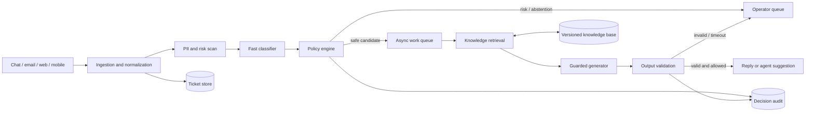

# Архитектура

## Границы PoC

В репозитории реализован один локальный процесс: правила, быстрый
классификатор, lexical retrieval, policy, детерминированный генератор и
JSONL-аудит. Опциональные Ollama/OpenRouter-адаптеры реализуют тот же
интерфейс, но по умолчанию выключены. Последовательное исполнение делает
поведение наблюдаемым в demo, но не имитирует брокер или распределённое
хранилище. Ниже описана целевая схема.

## Поток и граница горячего пути

Ingestion приводит каналы к единой схеме `Ticket`, назначает стабильный
ID и сохраняет исходник в защищённом ticket store. На синхронном пути
правила находят PII и high-risk сигналы, локальный классификатор возвращает
категорию и confidence, policy выбирает маршрут или abstention. Этот путь
не вызывает LLM и должен укладываться в ориентир 500 мс.

Для безопасного кандидата создаётся асинхронная задача. Retrieval получает
очищенный минимум текста и версию базы знаний; генератор видит только
найденный контекст и редактированный запрос. Валидатор проверяет наличие
PII, запрещённых обещаний и ссылок на действия, которых статья не
подтверждает. Рискованные категории сразу попадают оператору, генератор
для них не вызывается.

В PoC retrieval и генерация выполняются последовательно ради простоты CLI.
При этом safety-решение вычисляется до генератора, а его отказ не роняет
pipeline. Provider получает только очищенный текст и разрешённую статью;
локальный validator отклоняет PII, пустой/слишком длинный output и
несколько классов запрещённых обещаний. До production этого недостаточно:
нужны schema/groundedness checks и асинхронный execution.

Агрегированное поведение этой логической сети при ограниченных capacities
исследует отдельная [дискретно-событийная модель СМО](queueing-model.md).
Она не импортируется рабочим pipeline и не заменяет load test.

## Нагрузка и backpressure

Средний поток 200 000 тикетов/день — около 2,3 тикета/с, всплеск
10–20 тысяч за 10 минут — около 17–33 тикетов/с. Проектировать нужно по
всплеску, учитывая повторы доставки. Stateless-воркеры горячего пути
масштабируются отдельно от более дорогих async-воркеров.

Очередь ограничивает число одновременных генераций. При росте lag policy
сначала отключает необязательную генерацию для suggest-mode, затем
переводит безопасные случаи на утверждённые шаблоны, не задерживая
маршрутизацию. Приоритет получают security, billing и SLA-близкие тикеты,
но их ответ остаётся за оператором. Dead-letter queue хранит ссылку на
задачу и код ошибки, а не полный текст.

## Надёжность и incident mode

- Недоступность генератора открывает circuit breaker. Для узкой allowlist
  используется утверждённый шаблон; без шаблона — эскалация.
- Недоступность классификатора означает fail closed: `unknown` и очередь
  triage. Rules продолжают работать независимо.
- Недоступность audit store запрещает автоматическую отправку: решение
  без аудита не считается завершённым.
- В incident mode можно массово связать outage-тикеты с подтверждённым
  инцидентом и шаблоном. Новые категории не добавляются в auto-reply
  автоматически.

## Idempotency и аудит

В целевой системе ключ `(ticket_id, pipeline_version)` уникален в decision
store. Повторная доставка возвращает сохранённое решение; новая версия
pipeline создаёт новую ревизию без затирания истории. Отправка ответа и
фиксация решения связываются через transactional outbox.

PoC кэширует первое решение по ID только в рамках экземпляра процесса и
пишет одну строку JSONL. Межпроцессную идемпотентность он не обещает.
Аудит содержит сигналы, версии, scores, route, latency и fallback, но не
текст тикета, найденные email, телефон или номер карты.

## Данные и доступ

Исходные тикеты хранятся отдельно от feature/audit данных, шифруются и
доступны по ролям. Для обучения формируется деидентифицированный snapshot
с версией разметки и сроком удаления. База знаний версионируется; статья,
использованная в решении, воспроизводима по ID и версии. Оператор видит
причину эскалации и предложенный контекст, может исправить маршрут или
отклонить черновик; эти действия становятся delayed labels после проверки
качества.
