# Дискретно-событийная модель СМО

## Назначение

Основной PoC демонстрирует корректность принятия решения на уровне
отдельного тикета. СМО исследует агрегированное поведение тех же логических
этапов при случайном потоке и ограниченных ресурсах. Модель помогает
сравнить capacities, backpressure, деградацию LLM и incident-шаблон до
дорогого нагрузочного теста.

## Границы модели

Это не load test, не цифровой двойник и не доказательство production
capacity. Все интенсивности, latency и вероятности, кроме заданных объёмов
входного потока, являются инженерными assumptions. Результат показывает
следствия этих assumptions; перед решением о capacity их нужно
калибровать по telemetry.

Симуляция не вызывает реальный classifier, retrieval или LLM. Логические
узлы не подразумевают отдельный микросервис на каждый этап.

## Сеть СМО

Реализована открытая сеть очередей с вероятностным ветвлением:

1. источник создаёт категорию и условные признаки заявки;
2. конечный входной буфер и нормализация принимают тикет;
3. risk scan и classifier/policy образуют быстрый путь;
4. PII, high risk, low confidence, denylist и `operator_required` ведут
   только к оператору и не могут использовать fallback;
5. остальные заявки идут напрямую оператору либо в retrieval;
6. retrieval miss переводится в fallback для `service_outage`, иначе к
   оператору;
7. LLM учитывает provider state, timeout, конечную очередь и circuit
   breaker;
8. validator может отклонить output;
9. успешный outage получает auto-reply, остальные успешные черновики —
   operator review.

### Схема сети

Схема использует условные обозначения блок-схем по ГОСТ 19.701: овал —
начало или конечное состояние, параллелограмм — входные данные,
прямоугольник — обработка, ромб — решение, цилиндр — очередь с хранимыми
заявками. Цветовое кодирование намеренно не используется.

```mermaid
%%{init: {"theme": "base", "themeVariables": {"primaryColor": "#ffffff", "primaryTextColor": "#000000", "primaryBorderColor": "#000000", "secondaryColor": "#ffffff", "tertiaryColor": "#ffffff", "lineColor": "#000000", "edgeLabelBackground": "#ffffff"}}}%%
flowchart TB
    START([Начало])
    FLOW[/Входящий поток заявок<br/>piecewise Poisson и смесь категорий/]
    INPUT_Q[(Входной буфер<br/>K = 5000)]
    INPUT[Нормализация<br/>c = 16; LogNormal]
    RISK_Q[(Очередь PII / risk scan<br/>K = 2000)]
    RISK[PII / risk scan<br/>c = 8; LogNormal]
    POLICY_Q[(Очередь классификации<br/>K = 2000)]
    POLICY[Классификатор и policy<br/>c = 8; LogNormal]

    SAFETY{"PII, high risk,<br/>low confidence или denylist?"}
    OP_REQUIRED{"Оператор обязателен<br/>для категории?"}
    INCIDENT{"Активен incident-mode<br/>для service_outage?"}

    RETRIEVAL_Q[(Очередь retrieval<br/>K = 2000)]
    RETRIEVAL[Поиск статьи<br/>c = 16; LogNormal]
    HIT{"Статья найдена?<br/>P(hit | category)"}

    PROVIDER{"Provider healthy / degraded<br/>и circuit breaker закрыт?"}
    LLM_Q[(Очередь генерации<br/>K = 2000)]
    LLM[Генерация черновика<br/>c = 24; LogNormal; timeout = 8 s]
    GENERATED{"Генерация успешна?<br/>P(failure | provider state)"}

    VALIDATOR_Q[(Очередь валидации<br/>K = 1000)]
    VALIDATOR[Проверка ответа<br/>c = 8; LogNormal]
    VALID{"Ответ допустим?<br/>P(reject | category)"}
    ALLOWLIST{"Категория входит<br/>в auto-reply allowlist?"}
    SAFE_FALLBACK{"Есть утверждённый<br/>безопасный шаблон?"}

    OPERATOR_Q[(Очередь операторов<br/>K = 25000)]
    OPERATOR[Обработка оператором<br/>c = 1100; LogNormal]
    FALLBACK_Q[(Очередь fallback<br/>K = 1000)]
    FALLBACK[Утверждённый шаблон<br/>c = 8; LogNormal]

    AUTO_END([Автоматический ответ])
    OPERATOR_END([Обработано оператором])
    FALLBACK_END([Завершено через fallback])
    LOSS_END([Техническая потеря])

    START --> FLOW --> INPUT_Q --> INPUT --> RISK_Q --> RISK
    RISK --> POLICY_Q --> POLICY --> SAFETY

    SAFETY -- Да --> OPERATOR_Q
    SAFETY -- Нет --> OP_REQUIRED
    OP_REQUIRED -- Да --> OPERATOR_Q
    OP_REQUIRED -- Нет --> INCIDENT

    INCIDENT -- Да --> FALLBACK_Q
    INCIDENT -- Нет --> RETRIEVAL_Q --> RETRIEVAL --> HIT
    HIT -- Нет --> SAFE_FALLBACK
    HIT -- Да --> PROVIDER

    PROVIDER -- Нет --> SAFE_FALLBACK
    PROVIDER -- Да --> LLM_Q --> LLM --> GENERATED
    GENERATED -- Нет или timeout --> SAFE_FALLBACK
    GENERATED -- Да --> VALIDATOR_Q --> VALIDATOR --> VALID

    VALID -- Нет --> SAFE_FALLBACK
    VALID -- Да --> ALLOWLIST
    ALLOWLIST -- Да --> AUTO_END
    ALLOWLIST -- Нет --> OPERATOR_Q

    SAFE_FALLBACK -- Да --> FALLBACK_Q --> FALLBACK --> FALLBACK_END
    SAFE_FALLBACK -- Нет --> OPERATOR_Q
    OPERATOR_Q --> OPERATOR --> OPERATOR_END

    INPUT_Q -. Буфер переполнен .-> LOSS_END
    OPERATOR_Q -. Последняя очередь переполнена .-> LOSS_END
    LLM_Q -. Очередь переполнена .-> SAFE_FALLBACK
```



`c` обозначает число параллельных каналов обслуживания, `K` — конечную
ёмкость очереди. Точные параметры сценариев остаются в конфигурации и
таблицах ниже, чтобы схема описывала структуру, а не один запуск.

## Входящий поток

Baseline — пуассоновский поток с интенсивностью `200000 / 86400 ≈ 2.31`
тикета/с. Это удобное начальное приближение, а не утверждение о реальном
распределении. `arrival_periods` позволяет задать piecewise-интенсивность и
смесь категорий.

Burst длится с 300-й до 900-й секунды. В этом окне интенсивность равна
`20000 / 600 ≈ 33.33` тикета/с, а ожидаемая доля `service_outage`
увеличивается с 12% до 72%. До и после окна действует baseline. После
завершения arrivals модель продолжает drain-период для оценки
восстановления.

## Распределения обслуживания

Единица времени — секунда. Все узлы используют положительное lognormal
распределение: в конфигурации указаны арифметическое среднее и sigma
логарифма. Значения не являются замерами.

| Узел | c | K очереди | mean, s | sigma | Timeout | Смысл assumption |
|---|---:|---:|---:|---:|---:|---|
| input | 16 | 5000 | 0.005 | 0.25 | — | лёгкая нормализация |
| risk scan | 8 | 2000 | 0.025 | 0.30 | — | локальные rules |
| classifier/policy | 8 | 2000 | 0.040 | 0.30 | — | lightweight baseline |
| retrieval | 16 | 2000 | 0.200 | 0.45 | — | lexical/индексный поиск |
| LLM | 24 | 2000 | 1.800 | 0.65 | 8 s | длинный правый хвост |
| validator | 8 | 1000 | 0.035 | 0.30 | — | schema/PII checks |
| operator | 1100 | 25000 | 480 | 0.55 | — | около 8 минут в среднем |
| fallback | 8 | 1000 | 0.010 | 0.20 | — | утверждённый шаблон |

Utilization вычисляется как сумма пересечений интервалов занятости с
окном наблюдения, делённая на `c × observation time`. Незавершённая к
концу симуляции услуга учитывается только до границы окна.

## Условные переходы

Сначала выбирается категория, затем признаки из её строки. Таким образом,
события не имеют одинаковую независимую вероятность для всего потока.

| Category | P(PII) | P(high risk) | P(low confidence) | P(retrieval hit) | P(validation reject) | P(operator required) |
|---|---:|---:|---:|---:|---:|---:|
| service_outage | .01 | .01 | .04 | .94 | .01 | .02 |
| access_issue | .12 | .05 | .12 | .82 | .03 | .30 |
| payment_issue | .48 | .52 | .08 | .80 | .04 | 1.00 |
| refund_request | .38 | .45 | .10 | .78 | .05 | 1.00 |
| account_security | .20 | .78 | .10 | .76 | .05 | 1.00 |
| general_question | .05 | .01 | .10 | .86 | .03 | .55 |
| unknown | .08 | .08 | .68 | .35 | .08 | .90 |

Значения находятся в `simulation.config` и заменяются целиком для
эксперимента. Отдельные seeded RNG-потоки используются для arrivals,
атрибутов тикета, service times и provider failures, поэтому парное
сравнение сценариев сохраняет одинаковый внешний поток.

## Provider, circuit breaker и отказы

Provider бывает `healthy` и `degraded`. В degradation-интервале mean
LLM-latency умножается на 5, error probability растёт с 1% до 40%.
Три последовательных failure открывают circuit breaker на 60 секунд.
Открытый breaker не ставит новые заявки в LLM-очередь.

Термины разделены:

- **operator escalation** — штатный terminal path после обработки
  оператором;
- **automation rejection** — тикет дошёл до policy, но автоматический
  канал отказался из-за safety, confidence, miss, overflow, provider или
  validation; это не потеря;
- **fallback** — безопасно завершённый утверждённым outage-шаблоном тикет;
- **timeout** — LLM service time превысил 8 секунд;
- **system loss** — тикет технически не принят либо не может быть сохранён
  ни в одном доступном пути.

В знаменатель `tickets_considered_for_automation` входят все тикеты,
дошедшие до policy, включая high-risk/PII, которые немедленно отклонены
rules. Поэтому:

```text
automation_rejection_probability =
    automation_rejections / tickets_considered_for_automation

system_loss_probability = lost / arrived
```

Переполнение LLM-очереди означает automation rejection и fallback/operator,
но не system loss. Переполнение входного буфера либо последнего доступного
operator buffer считается loss. Стандартные сценарии настроены на
сохранение заявок; loss-поведение отдельно проверено тестом перегрузки.

## Метрики

Отчёт содержит balance:

```text
arrived = completed + lost + unfinished
completed = auto_replied + fallback_completed + sent_to_operator
```

Также считаются throughput, rates, SLA violations, mean/p50/p95/p99 total
time, mean/p95 wait, max queue и utilization каждого узла, LLM requests,
timeouts, breaker bypass, bottleneck и recovery time. Percentile пустой
выборки равен нулю, поэтому JSON не содержит `NaN`/`Infinity`.

Recovery — первое 10-секундное наблюдение после burst, когда очереди
input/risk/classifier/retrieval/LLM не превышают пять заявок. Operator
backlog показан отдельно и намеренно не маскируется этой метрикой.

## Сценарии и результаты

- **baseline:** средняя нагрузка, healthy provider;
- **burst:** 20 тысяч ожидаемых arrivals за 10 минут и outage mix;
- **llm-degradation:** интервал повышенной latency/errors и breaker;
- **incident-mode:** тот же burst и seed, но подтверждённый outage получает
  шаблон без LLM.

Реальный запуск `compare --seed 42` дал:

| Scenario | Arrived | Completed | Lost | Unfinished | LLM requests | Rejection p | p95 total, s | Recovery, s |
|---|---:|---:|---:|---:|---:|---:|---:|---:|
| baseline | 8318 | 8313 | 0 | 5 | 2606 | .700 | 971.3 | — |
| burst | 22765 | 22754 | 0 | 11 | 10468 | .554 | 2656.6 | 130 |
| llm-degradation | 4129 | 4128 | 0 | 1 | 772 | .845 | 980.3 | — |
| incident-mode | 22765 | 22754 | 0 | 11 | 2033 | .335 | 2650.0 | 0 |

Это результат конфигурации, не прогноз production. Парное сравнение burst
и incident-mode показывает ожидаемый механизм: шаблон уменьшил LLM load и
automation rejection без расширения auto-reply allowlist. Safety-отказы
не используют fallback, поэтому burst и incident-mode сохраняют одинаковую
нагрузку на операторов; incident template влияет только на безопасный
automated path. Высокий общий p95 определяется в основном operator path;
bottleneck во всех четырёх запусках — operator.

## Ограничения и калибровка

Модель не учитывает суточную корреляцию, повторные доставки, приоритеты
операторов, смены, skill-based routing, autoscaling delay, сеть и общие
provider rate limits. Bernoulli-переходы условны по категории, но не
моделируют корреляцию нескольких признаков внутри категории.

Для калибровки нужны реальные inter-arrival distributions и incident
replays, latency histograms по этапам, category/channel mix,
confidence/retrieval distributions, timeout/error rates, operator handling
time, queue telemetry, SLA и provider limits. После калибровки сравниваются
не одиночные seeds, а распределения результатов по множеству репликаций с
доверительными интервалами.
